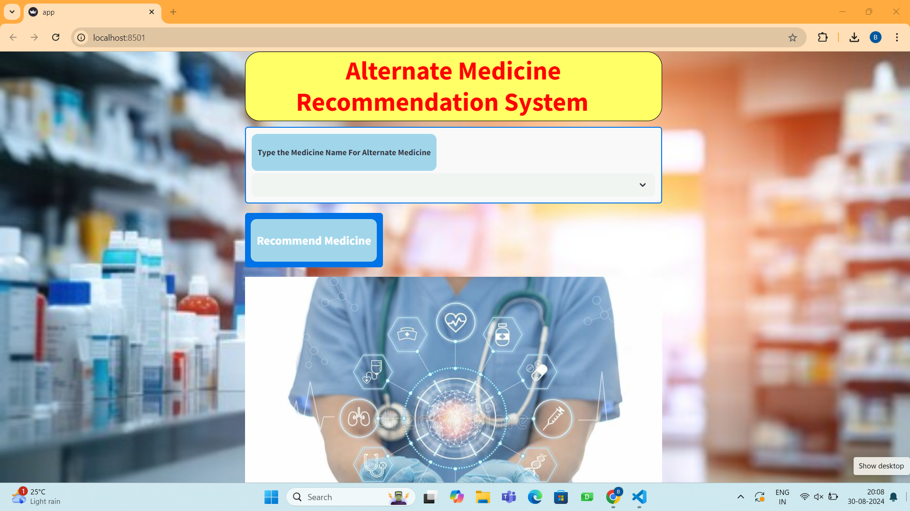
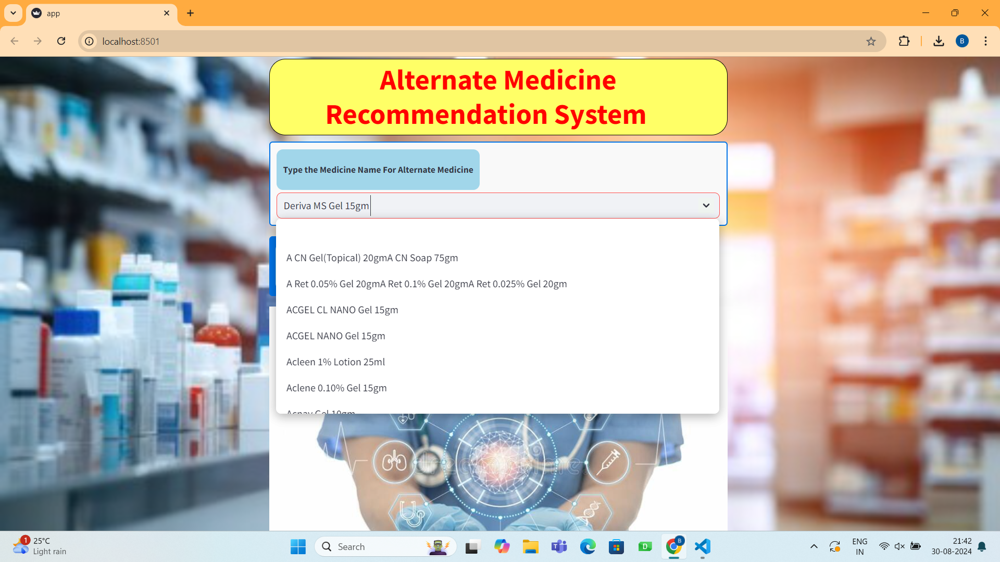
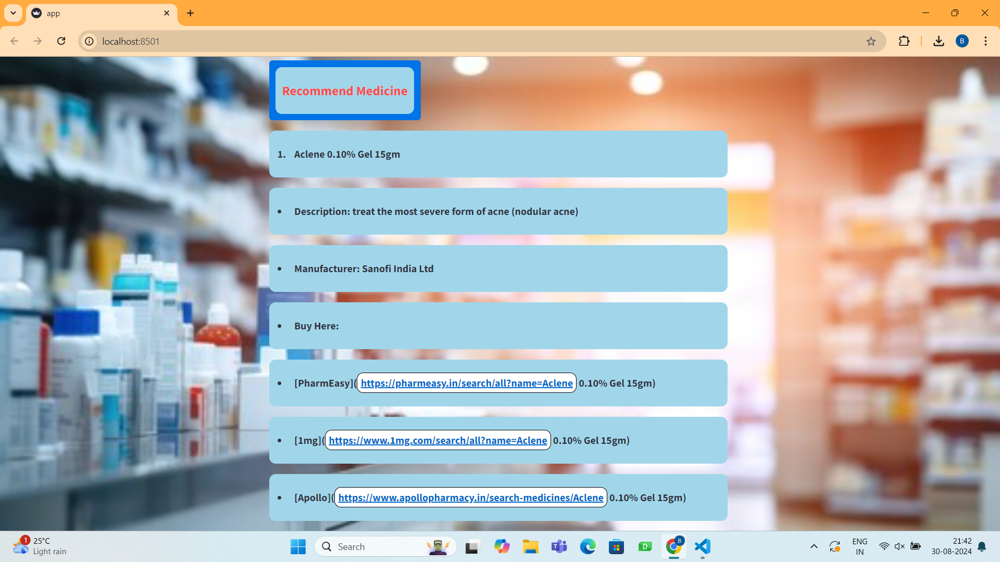
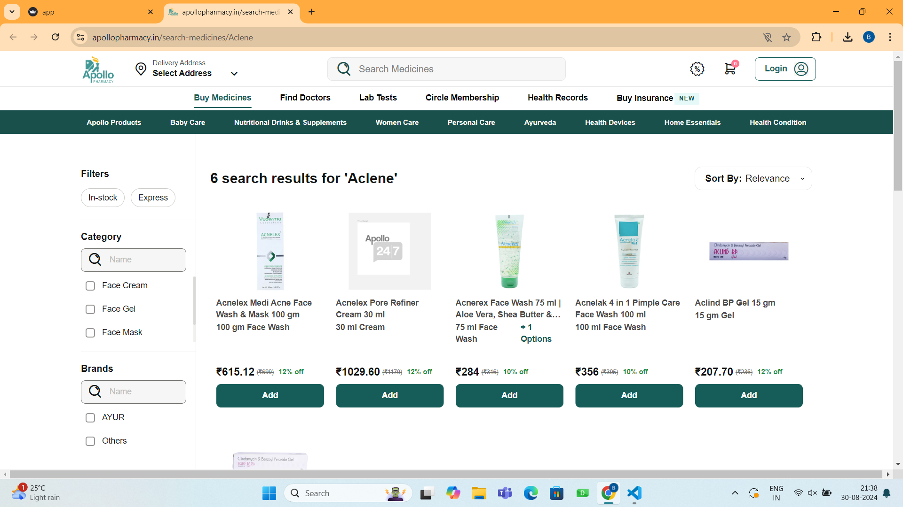
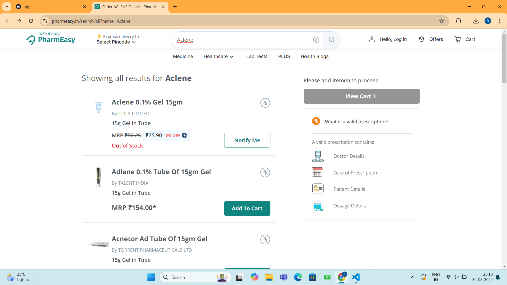

# Alternate-Medicine-Recommendation-System
## 📌 1. Project Overview

The Alternate Medicine Recommendation System is a machine learning-based application developed to help users find alternative medicines for a particular medicine.
Sometimes, prescribed medicines may be unavailable in pharmacies, may have different price ranges, or users may not be aware of other available alternatives. This system helps users explore alternative medicine options by entering the name of a medicine.
The application uses a medicine dataset and a similarity-based recommendation approach to identify and display the top 5 alternative medicines related to the selected medicine.
It also provides additional medicine information and links to pharmacy platforms such as Apollo Pharmacy and PharmEasy, helping users explore the recommended alternatives. The application is developed using Python and Streamlit, with medicine information stored in an Excel dataset.

## 🎯 2. Problem Statement

Finding alternative medicines can be difficult when a particular medicine is unavailable or when users are unaware of other available options.
Users may need to spend additional time searching for medicines with similar characteristics.
This project aims to simplify the process by providing a system that recommends alternative medicines based on the medicine selected by the user.

## 🎯 3. Objectives of the Project

- To develop an application that recommends alternative medicines.

- To identify medicines similar to the selected medicine.

- To display the top 5 recommended alternatives.

- To provide relevant information about recommended medicines.

- To provide access to pharmacy platforms for exploring medicine availability.

- To improve awareness of alternative medicine options.

- To make the medicine search and recommendation process simple and convenient.

## 💡 4. Why Do We Need This System?

### 1. Medicine Availability
Sometimes, particular medicines may be unavailable in pharmacies. Finding alternative options can help users explore other possibilities.

### 2. Cost Efficiency
Different medicines may have different prices. The system helps users explore alternatives that may have different price ranges.

### 3. Awareness
Users may not know about other available medicines with similar characteristics. This application helps them discover alternative options.

### 4. Convenience
Instead of manually searching for alternatives, users can enter a medicine name and view recommended options in one place.

## 🛠️ 5. Technologies Used
- Python
- Streamlit
- Pandas
- Scikit-learn
- Cosine Similarity
- Excel
- Pickle

## ⚙️ 6. Working Process
The system follows a similarity-based recommendation process.

### Step 1: User Input
The user opens the application and enters or selects the name of a medicine.

### Step 2: Medicine Search
The application checks the selected medicine against the available medicine information.

### Step 3: Similarity Calculation
The system uses a similarity algorithm based on Cosine Similarity to identify medicines that are related to the selected medicine.
Cosine Similarity measures the similarity between two data representations using the cosine of the angle between them.

### Step 4: Recommendation Generation
Based on the similarity results, the system identifies the top 5 alternative medicines.

### Step 5: Display Results
The recommended medicines are displayed to the user along with available medicine information.

### Step 6: Pharmacy Links
Users can explore pharmacy platforms such as Apollo Pharmacy and PharmEasy for additional information.

## 📸 7. Application Screenshots

### 🏠 Home Page

The home page provides the main interface of the application, where users can start searching for alternative medicines.

### 🔍 Medicine Search

Users can search for a particular medicine using the medicine search interface.

### 💊 Medicine Recommendations

The application displays the top 5 recommended alternative medicines based on the selected medicine.

### 🏥 Apollo Pharmacy

The application provides an option to explore medicine information through Apollo Pharmacy.

### 🛒 PharmEasy

Users can also explore medicine information through PharmEasy.

## 📂 8. Project Structure

The repository contains the following files:

Alternate-Medicine-Recommendation-System/
│
├── app.py
├── Medicine_description.xlsx
├── medicine_dict.pkl
├── Home.png
├── Search.png
├── Recommend.png
├── Apollo.png
├── PharmEasy.png
└── README.md

## 🚀 9. Installation and Execution

Follow these steps to run the project on your local computer.

### Prerequisites

Make sure you have the following installed:

- Python

- pip (Python package manager)

### Step 1: Clone the Repository

git clone https://github.com/Chinmay02-04/Alternate-Medicine-Recommendation-System.git

### Step 2: Navigate to the Project Directory

cd Alternate-Medicine-Recommendation-System

### Step 3: Install Required Libraries

pip install streamlit pandas scikit-learn openpyxl

### Step 4: Run the Application

streamlit run app.py

### Step 5: Open the Application

After executing the command, Streamlit will provide a local URL in the terminal.

Open the URL in your web browser to access the application.
